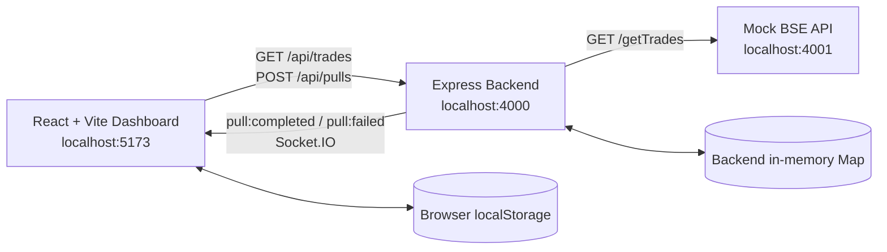
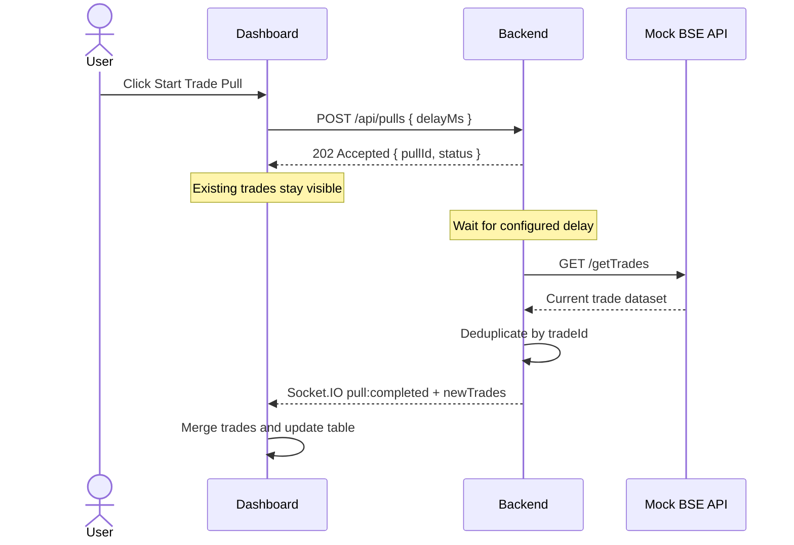

# Architecture Note

## Component diagram

## Responsibilities

### Mock BSE API

The mock service seeds 3,000 trades at startup and exposes `GET /getTrades`. It also exposes endpoints to start a simulated pull and inspect its status. The sample trade fields are `tradeId`, `client`, `symbol`, `quantity`, `price`, and `timestamp`.

### Backend

The Express backend exposes the dashboard-facing API. `GET /api/trades` returns trades currently held by the backend. `POST /api/pulls` responds with HTTP 202 and performs the delayed work asynchronously. After the delay, it requests the mock API's trade list, adds trade IDs it has not seen before, and emits a Socket.IO completion event. If fetching fails, it emits a failure event.

### Dashboard

The React dashboard loads backend trades on startup, using `localStorage` as an initial display cache. It opens a Socket.IO connection and handles completion and failure events. Incoming trades are deduplicated by `tradeId`, shown in a paginated table, and cached locally.

## Pull workflow

## Design rationale

- **Separate source simulation from dashboard API:** the mock exchange and the dashboard-facing backend have distinct responsibilities.
- **Asynchronous pull response:** returning HTTP 202 allows the dashboard to remain interactive while the pull is in progress.
- **Socket.IO for updates:** the backend pushes completion events to connected dashboards instead of requiring a page refresh or a frontend polling loop.
- **Trade-ID deduplication:** the backend and dashboard avoid displaying the same trade more than once.
- **Small in-memory implementation:** the code uses simple Maps and arrays, keeping the assessment easy to run locally without an additional database or queue.
